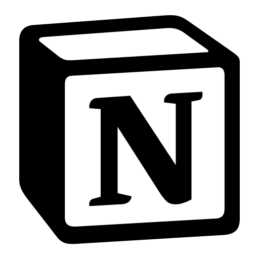

# Notion Desktop

[](https://github.com/e-slzr/notion-desktop/actions/workflows/release.yml)
[](LICENSE)
[](https://github.com/e-slzr/notion-desktop/releases)
[-lightgrey.svg)](https://github.com/e-slzr/notion-desktop)

Cliente de escritorio independiente, ligero y elegante para Notion en Linux, diseñado para ofrecer una experiencia de trabajo fluida y nativa sin pestañas de navegador innecesarias ni sobrecarga de recursos.

<p align="center">
  
</p>

---

## Características

- **Autenticación unificada y segura:** Compatible con inicio de sesión mediante Google OAuth, Apple ID, Microsoft y proveedores corporativos SSO/SAML (Okta, Auth0), resuelto directamente en la aplicación sin advertencias de navegador no confiable.
- **Navegación histórica integrada:** Botones dedicados de retroceso y avance en la barra de título, complementados con atajos de teclado estándar (`Alt + ←`, `Alt + →`) para desplazarse cómodamente entre páginas y documentos.
- **Diseño minimalista adaptativo:** Barra de título personalizada inspirada en la paleta visual de Notion, con adaptación automática al tema oscuro o claro del sistema operativo.
- **Controles de ventana consistentes:** Botones integrados de recarga rápida (`↻`), minimizar, maximizar y cerrar con transiciones suaves y área de arrastre completa.
- **Integración con Linux (Wayland y X11):** Sincronización continua de redimensionamiento bidireccional mediante IPC para evitar congelamientos de superficie gráfica en compositores Wayland y tarjetas gráficas dedicadas.
- **Persistencia de sesión y ventana:** Almacenamiento seguro de credenciales y estado (`persist:notion`), recordando tamaño, estado maximizado y última página visualizada.
- **Corrector ortográfico multilingüe:** Soporte simultáneo para detección y corrección en español e inglés.
- **Navegación externa segura:** Apertura automática de hipervínculos externos en el navegador predeterminado del sistema operativo.
- **Bajo consumo de recursos:** Ejecución optimizada sobre Electron con aceleración por hardware y mínimo consumo de memoria en reposo.

---

## Descargas (v1.0.0)

Los paquetes compilados listos para usar se encuentran disponibles en la sección de [Releases](https://github.com/e-slzr/notion-desktop/releases) o en la carpeta `dist/`:

| Plataforma | Formato | Descripción |
|---|---|---|
| **Linux** | `.AppImage` | Ejecutable portable universal (compatible con cualquier distribución Linux). |
| **Linux** | `.deb` | Instalador nativo para Ubuntu, Debian, elementary OS, Linux Mint y derivados. |

---

## Atajos de teclado

| Atajo | Acción |
|---|---|
| `Alt + ←` | Retroceder a la página anterior |
| `Alt + →` | Avanzar a la página siguiente |
| `Ctrl + R` / `F5` | Recargar espacio de trabajo |
| `Ctrl + Q` | Cerrar completamente la aplicación |
| `Ctrl + W` | Ocultar ventana en segundo plano |
| Doble clic en barra | Maximizar / Restaurar tamaño |

---

## Instalación rápida en Linux (elementary OS / Ubuntu)

Para integrar la versión de Linux directamente en el menú de aplicaciones y el Dock del sistema:

```bash
./install-app.sh
```

---

## Desarrollo y Compilación

### Requisitos previos
- [Node.js](https://nodejs.org/) (versión 20 o superior)
- npm

### Pasos
```bash
# Clonar el repositorio
git clone https://github.com/e-slzr/notion-desktop.git
cd notion-desktop

# Instalar dependencias
npm install

# Iniciar en modo desarrollo
npm start

# Compilar instaladores para Linux (AppImage y .deb)
npm run dist:linux
```

---

## Autor

**Eliu Salazar**  
- GitHub: [@e-slzr](https://github.com/e-slzr)  
- Contacto: [eliu.asalazar@gmail.com](mailto:eliu.asalazar@gmail.com)

---

## Licencia

Este proyecto está bajo la Licencia **MIT**. Consulta el archivo [LICENSE](LICENSE) para más detalles.

---

## Aviso de Marcas y Exención de Responsabilidad (Disclaimer)

**Notion™** y el logotipo de Notion son marcas registradas de **Notion Labs, Inc.**

Este proyecto es un cliente de escritorio independiente de código abierto y **no está afiliado, patrocinado, respaldado ni autorizado oficialmente por Notion Labs, Inc.** ni por ninguna de sus filiales. Todos los nombres comerciales, marcas comerciales y logotipos son propiedad de sus respectivos dueños y se utilizan aquí únicamente con fines de identificación y compatibilidad en entornos Linux.
